# GOH TIAN YOU – Portfolio

I am an IT diploma graduate (Sunway College, September 2026) from Ipoh, Perak. I build web apps with Next.js, Supabase and Vercel, and I use Claude Code to write most of the code. I write the requirements and check every change myself.

The source code of my projects is private (one of them belongs to a client). This page shows what I built. A live demo with sample data is linked below.

**Contact:** 011-1656 5280 (WhatsApp) · tianyougoh3@gmail.com

---

## 1. Dealer Management System (CRM + Ledger)

A contract project for a prepaid-SIM master dealer. The client uses it now.

**Live demo (sample data, no login needed):** https://vibe456-demo.vercel.app

**Why I built it:** The dealer used to keep all records in Excel and type everything in one by one. They asked me to help, so I built a system that works on a computer and on a phone. Now they can find records faster and see how much they earned each month.

**What I built (all of it, on my own, with Claude Code):**
- Three staff roles (owner, finance, customer service). Row-Level Security in the database controls who can see what, so customer service cannot see financial data.
- A ledger where records are never edited or deleted. A second person checks each transaction. Corrections are added as new linked records.
- A monthly check against the carrier's statement. AI reads the dealers' bank transfer slips, fills in the amount, date, bank and reference, and marks anything that does not match.
- SIM stock by card type and delivery status. Dealers send top-up or SIM requests from their phone through a link, without logging in.
- A mobile web app (PWA) that staff can install on their phone. Staff get a notification when a new order comes in.
- Every change goes through a pull request. It must pass type check, lint, tests and a build before it is merged.

**What I found and fixed:**
- I logged in as a lower-level role and sent requests straight to the database. A checked transaction could still be edited, a closed month could be reopened, and an entry with a negative amount could give free credit. The screens did not allow this, but the database did. I fixed it with database triggers and policies.
- A list query stopped at 1,000 rows without any warning, so the totals were too low. Now the totals are calculated in the database.
- I check the live page after every deploy. Once a deploy passed all the checks but was still showing an old stylesheet.

**Built with:** Next.js, TypeScript, Supabase (PostgreSQL), Vercel, GitHub Actions.

### Mobile
| | |
|---|---|
| 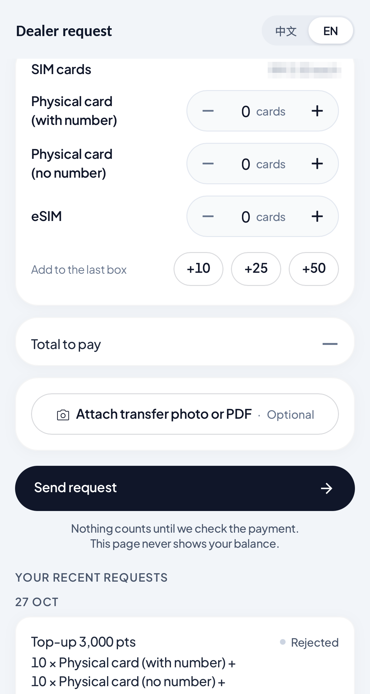 | 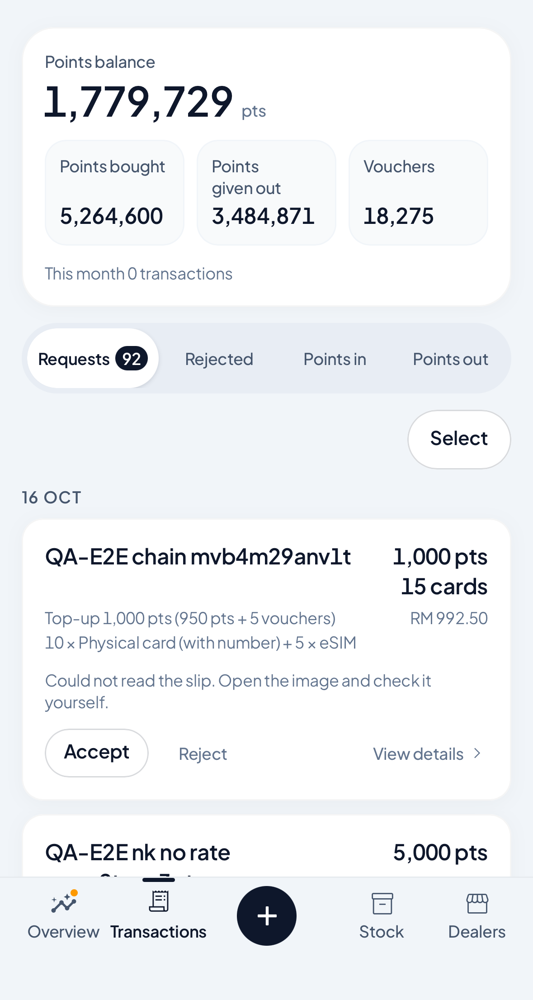 |
| Dealer request page. Dealers open a link on their phone and send a request. No login. | Requests queue. Staff accept or reject requests. |
| 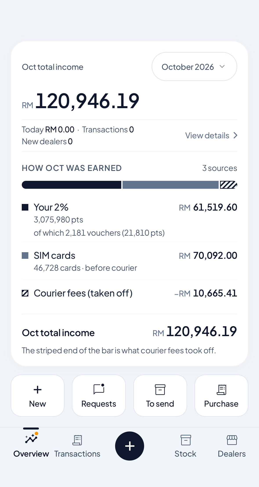 | 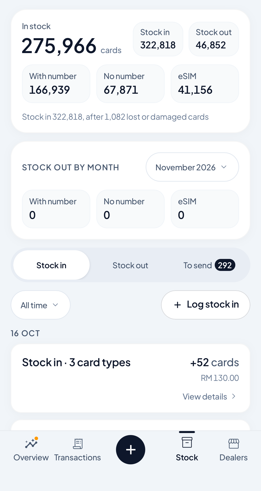 |
| Overview. Monthly income and how it was earned. | SIM stock by card type, with a to-send list. |

### Desktop
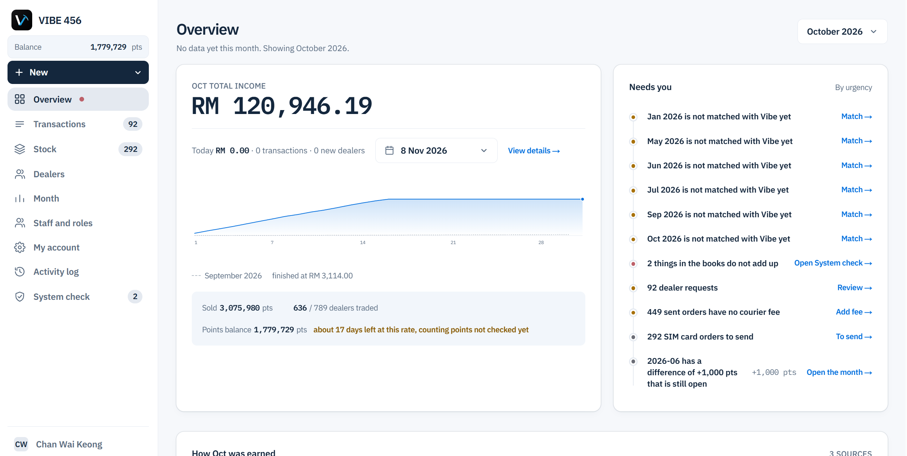
Overview: monthly income and a list of what needs attention.

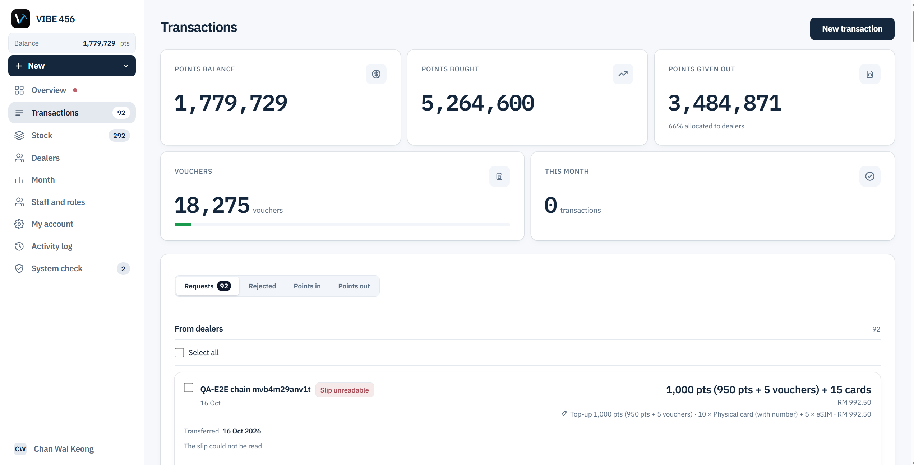
Transactions: points bought and given out, and requests waiting for review.

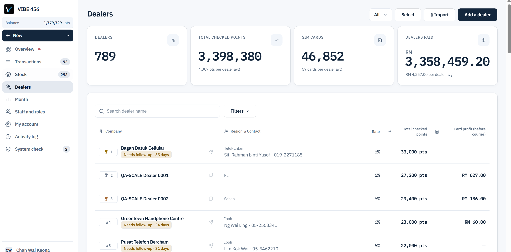
Dealers: rate, total points, and reminders for dealers who have not ordered for a while.

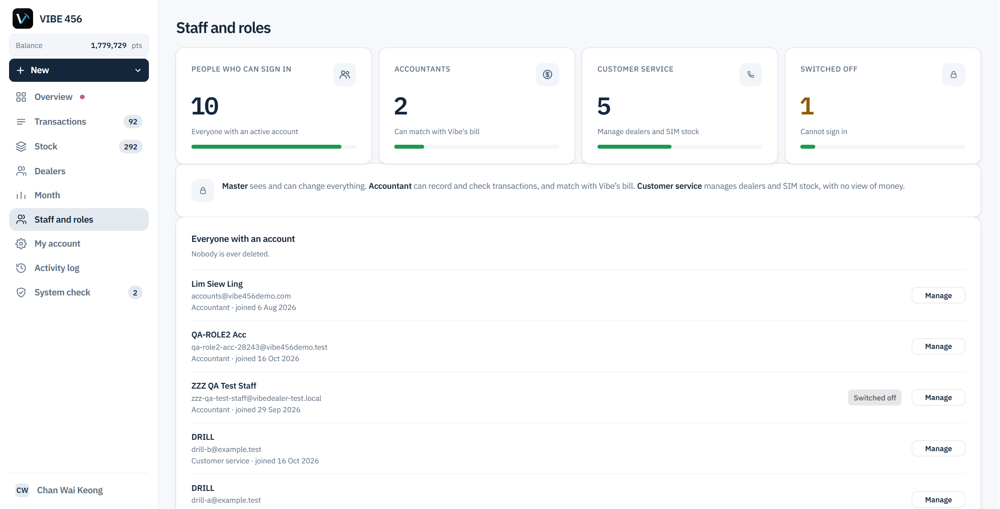
Staff and roles: three roles with different access.

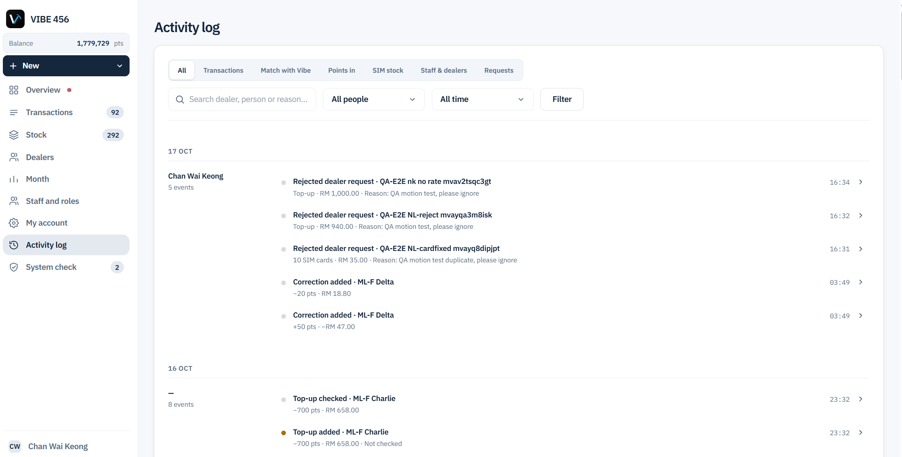
Activity log: every action is recorded with who did it and when.

*All screens use sample data, not real client data.*

---

## 2. Salon Management System (in development, most features complete)

A system for hair salons and beauty businesses: appointments, checkout, stock, staff commission and client records. I built it on my own, because I wanted to see if I could build a full system by myself.

**What I built:**
- Appointment booking, checkout, prepaid packages and memberships, stock and purchase orders, and staff commission with different percentage levels.
- An end-of-day cash count: staff count the cash by note and coin, and the system compares it with the expected total.
- Customers can cancel their own booking or leave a review from a link, without making an account.
- Owner-only data (revenue, commission, payroll) is kept apart from what staff can see (schedule, stock) using Row-Level Security. I tested it by logging in as a staff account and calling the database directly.

**What I found and fixed:**
- Two staff could count the same stock item, or use the same customer's store credit, at the same time, and both would go through. I reproduced it by sending two requests at once, fixed it with a row lock, and tested again.
- I checked every database function for permission problems. Four of them let a logged-in user change another business's data by guessing an ID. I also found that Postgres lets every logged-in user run a function unless you remove that right, and I had missed this on many functions. I fixed all of them.

**Built with:** Next.js, Supabase (PostgreSQL), Vercel.

| | |
|---|---|
| 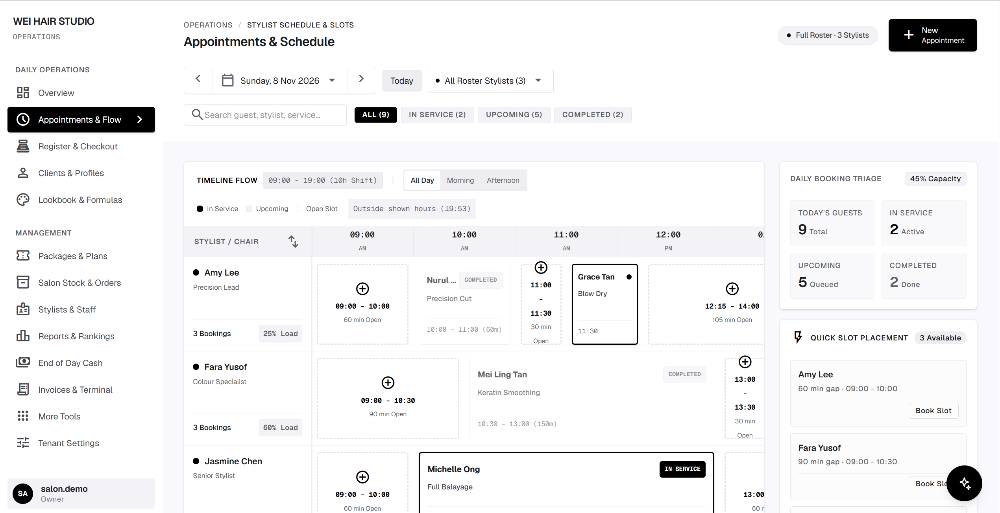 | 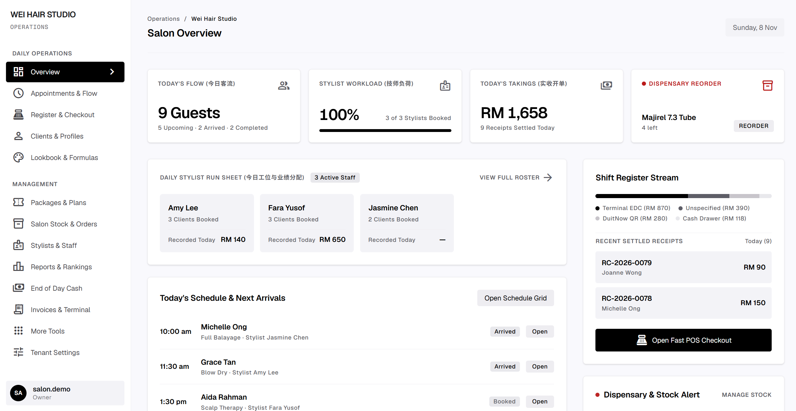 |
| Appointments: each stylist's day on a timeline, with open slots. | Daily overview: guests, stylist workload, takings, low stock. |
| 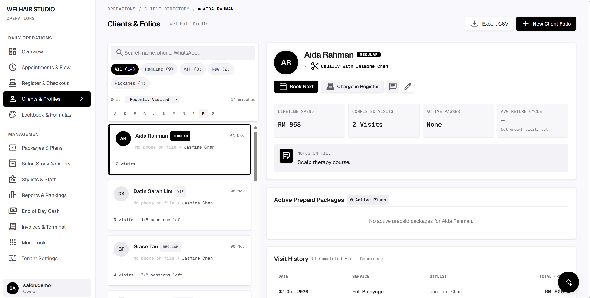 | 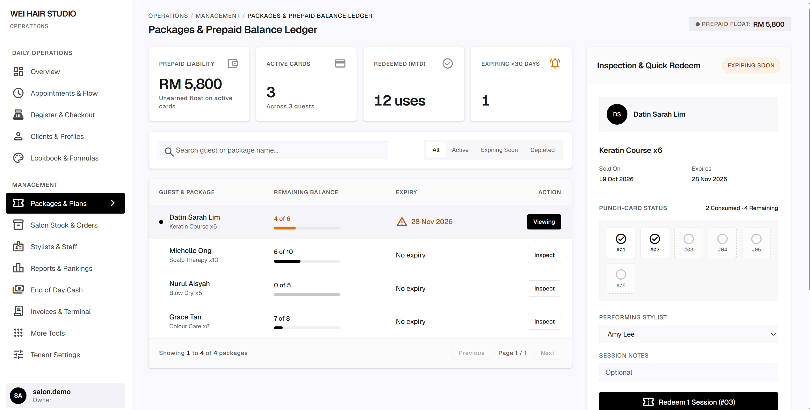 |
| Client profiles: visit history, spend, packages, notes. | Prepaid packages: what each customer has left and when it expires. |

*All screens use a demo salon with sample data.*

---

## 3. Smart House System (final-year project, Sunway College)

A system for apartment management: visitor registration, visitor parking and facility booking.

- Visitors scan a QR code and fill in their own details. Visitor parking works the same way.
- I chose this project because at my own apartment the guards register many visitors and the visitor parking is often full. I wanted to make it easier for the management.
- I built it on my own with Claude Code, Next.js, Supabase and Vercel, and showed it to my lecturer.

---

## Experience

**AI Chatbot and AI SaaS Intern – CreatiQ AI Solution, April – August 2026**
- Wrote and adjusted chatbot prompts for clients, so each chatbot sounded like the business and answered its real questions.
- Helped clients start using their chatbot, and changed the prompts based on their feedback and real conversations.
- Helped develop the company's AI SaaS. It makes ad images and videos with AI and posts them to Facebook and Instagram on a schedule.
